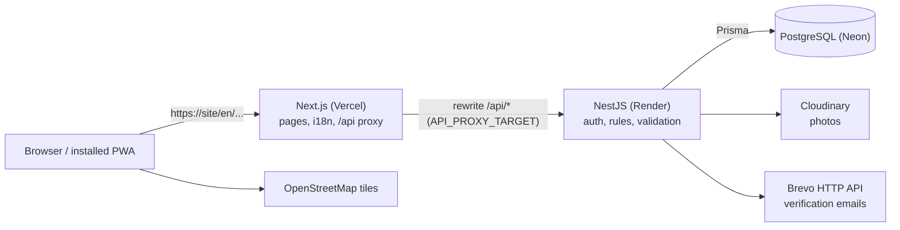
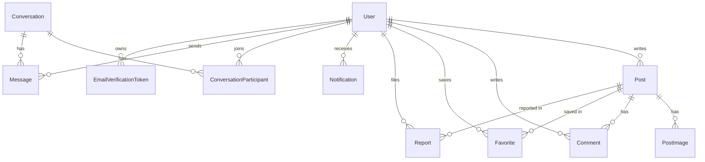
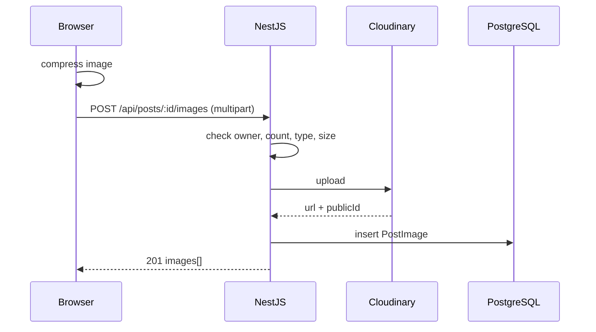

# 02. Technical Specification

This is the single source of truth for architecture, database, API and frontend design. If the code changes, update this file in the same commit.

## 1. Architecture



Locally: Next.js on `:3000`, NestJS on `:4000` (API at `/api`, Swagger at `/api/docs`), PostgreSQL on `:5432`.

The frontend never talks to the database. Only the backend does.

## 2. Monorepo structure

One Git repository (`Community-Board/`). `client/` and `server/` never have their own Git.

```
Community-Board/
├── client/                           FRONTEND: Next.js (Vercel)
│   ├── messages/                     en.json (source), tg.json, ru.json
│   ├── public/                       logo.svg, favicon, PWA icons (192, 512, maskable), images
│   ├── src/
│   │   ├── app/
│   │   │   ├── [locale]/             every page lives under /en, /ru, /tg
│   │   │   │   ├── layout.tsx        providers + Navbar / MobileTopBar / BottomTabBar
│   │   │   │   ├── page.tsx          browse page (home)
│   │   │   │   ├── posts/[id]/       post detail (+ edit/)
│   │   │   │   ├── posts/new/        create post
│   │   │   │   ├── login/  register/
│   │   │   │   ├── profile/  saved/  notifications/  messages/  settings/  about/
│   │   │   │   ├── users/[username]/ public profile
│   │   │   │   └── admin/            dashboard, reports, posts, users
│   │   │   ├── manifest.ts           PWA manifest
│   │   │   ├── sw.ts                 service worker (@serwist/next)
│   │   │   └── globals.css           Tailwind + design tokens (@theme) + motion tokens
│   │   ├── components/
│   │   │   ├── ui/                   shadcn/ui components
│   │   │   ├── layout/               Navbar, MobileTopBar, BottomTabBar, MobileDrawer, AdminSidebar
│   │   │   └── shared/               PostCard, EmptyState, Skeletons, Pagination, Logo...
│   │   ├── features/<feature>/       auth, posts, comments, favorites, reports,
│   │   │   ├── api.ts                notifications, messages, admin, users, uploads
│   │   │   ├── queries.ts
│   │   │   ├── mutations.ts
│   │   │   ├── schemas.ts            Zod form schemas
│   │   │   └── components/
│   │   ├── i18n/                     next-intl routing and request config
│   │   ├── lib/
│   │   │   ├── api/axios.ts          the one shared Axios instance
│   │   │   ├── api/schema.d.ts       generated from Swagger (npm run api:types)
│   │   │   ├── query-client.ts
│   │   │   ├── motion.ts
│   │   │   └── utils.ts
│   │   └── middleware.ts             locale detection + protected routes
│   ├── next.config.ts                /api proxy rewrite, next-intl, Serwist
│   └── package.json
├── server/                           BACKEND: NestJS + Prisma (Render)
│   ├── prisma/  schema.prisma, migrations/, seed.ts
│   ├── src/
│   │   ├── main.ts                   /api prefix, Swagger, helmet, cookies, CORS, pipes
│   │   ├── app.module.ts
│   │   ├── common/                   guards, decorators, exception filter, error codes, shared DTOs
│   │   ├── config/                   env validation, allowed university domains
│   │   ├── prisma/                   PrismaService
│   │   └── modules/<module>/         auth, users, posts, comments, uploads, favorites, reports,
│   │       ├── <module>.module.ts    notifications, messages, admin, mail, tasks, health
│   │       ├── <module>.controller.ts
│   │       ├── <module>.service.ts
│   │       ├── <module>.service.spec.ts
│   │       └── dto/
│   ├── test/                         e2e tests (Supertest)
│   └── package.json
├── docs/                             01–12
├── .github/workflows/  ci.yml, keep-awake.yml
├── docker-compose.yml                optional local PostgreSQL
├── package.json  .gitignore  .prettierrc  README.md  CLAUDE.md
```

## 3. Database

### 3.1 Prisma schema (target for day 2)

```prisma
generator client {
  provider = "prisma-client-js"
}

datasource db {
  provider = "postgresql"
  url      = env("DATABASE_URL")
}

enum Role               { USER ADMIN }
enum Category           { LOST_FOUND TUTORING RENTALS OTHER }
enum District           { SINO FIRDAVSI SHOHMANSUR ISMOILI_SOMONI UNIVERSITY_CAMPUS OTHER }
enum PostStatus         { ACTIVE RESOLVED EXPIRED REMOVED }
enum PriceUnit          { ONCE PER_HOUR PER_MONTH }
enum ReportReason       { SPAM SCAM OFFENSIVE OTHER }
enum ReportStatus       { OPEN RESOLVED DISMISSED }
enum NotificationType   { NEW_COMMENT POST_EXPIRING POST_REMOVED NEW_MESSAGE }
enum Locale             { TG RU EN }

model User {
  id                String   @id @default(cuid())
  email             String   @unique
  username          String   @unique
  passwordHash      String
  role              Role     @default(USER)
  isBlocked         Boolean  @default(false)
  universityEmail   String?  @unique
  isStudentVerified Boolean  @default(false)
  preferredLocale   Locale   @default(EN)
  createdAt         DateTime @default(now())
  updatedAt         DateTime @updatedAt

  posts                   Post[]
  comments                Comment[]
  favorites               Favorite[]
  reports                 Report[]                 @relation("Reporter")
  notifications           Notification[]           @relation("NotificationOwner")
  conversations           ConversationParticipant[]
  messages                Message[]
  emailVerificationTokens EmailVerificationToken[]
}

model Post {
  id                  String     @id @default(cuid())
  title               String     @db.VarChar(120)
  description         String     @db.Text
  category            Category
  district            District
  status              PostStatus @default(ACTIVE)
  price               Int?
  priceUnit           PriceUnit?
  contactTelegram     String?
  contactPhone        String?
  latitude            Float?
  longitude           Float?
  expiresAt           DateTime
  expiryWarningSentAt DateTime?
  removedReason       String?
  authorId            String
  author              User       @relation(fields: [authorId], references: [id], onDelete: Cascade)
  createdAt           DateTime   @default(now())
  updatedAt           DateTime   @updatedAt

  images    PostImage[]
  comments  Comment[]
  favorites Favorite[]
  reports   Report[]

  @@index([category])
  @@index([district])
  @@index([status])
  @@index([createdAt])
  @@index([authorId])
  @@index([status, expiresAt])
}

model PostImage {
  id        String   @id @default(cuid())
  postId    String
  post      Post     @relation(fields: [postId], references: [id], onDelete: Cascade)
  url       String
  publicId  String   // Cloudinary id, needed to delete the file
  position  Int      @default(0)
  createdAt DateTime @default(now())

  @@index([postId, position])
}

model Comment {
  id        String   @id @default(cuid())
  body      String   @db.VarChar(1000)
  postId    String
  post      Post     @relation(fields: [postId], references: [id], onDelete: Cascade)
  authorId  String
  author    User     @relation(fields: [authorId], references: [id], onDelete: Cascade)
  createdAt DateTime @default(now())

  @@index([postId, createdAt])
  @@index([authorId])
}

model Favorite {
  userId    String
  postId    String
  user      User     @relation(fields: [userId], references: [id], onDelete: Cascade)
  post      Post     @relation(fields: [postId], references: [id], onDelete: Cascade)
  createdAt DateTime @default(now())

  @@id([userId, postId])
  @@index([postId])
}

model Report {
  id         String       @id @default(cuid())
  postId     String
  post       Post         @relation(fields: [postId], references: [id], onDelete: Cascade)
  reporterId String
  reporter   User         @relation("Reporter", fields: [reporterId], references: [id], onDelete: Cascade)
  reason     ReportReason
  details    String?      @db.VarChar(500)
  status     ReportStatus @default(OPEN)
  createdAt  DateTime     @default(now())
  resolvedAt DateTime?

  @@unique([postId, reporterId])
  @@index([status, createdAt])
}

model Notification {
  id             String           @id @default(cuid())
  userId         String
  user           User             @relation("NotificationOwner", fields: [userId], references: [id], onDelete: Cascade)
  type           NotificationType
  postId         String?          // link target; no relation so it survives post deletion
  conversationId String?
  actorUsername  String?          // who commented / wrote (a copy, shown in the UI text)
  readAt         DateTime?
  createdAt      DateTime         @default(now())

  @@index([userId, readAt, createdAt])
}

model Conversation {
  id            String   @id @default(cuid())
  lastMessageAt DateTime @default(now())
  createdAt     DateTime @default(now())

  participants ConversationParticipant[]
  messages     Message[]

  @@index([lastMessageAt])
}

model ConversationParticipant {
  conversationId String
  userId         String
  conversation   Conversation @relation(fields: [conversationId], references: [id], onDelete: Cascade)
  user           User         @relation(fields: [userId], references: [id], onDelete: Cascade)
  lastReadAt     DateTime     @default(now())

  @@id([conversationId, userId])
  @@index([userId])
}

model Message {
  id             String       @id @default(cuid())
  conversationId String
  conversation   Conversation @relation(fields: [conversationId], references: [id], onDelete: Cascade)
  senderId       String
  sender         User         @relation(fields: [senderId], references: [id], onDelete: Cascade)
  body           String       @db.VarChar(2000)
  createdAt      DateTime     @default(now())

  @@index([conversationId, createdAt])
}

model EmailVerificationToken {
  id              String    @id @default(cuid())
  userId          String
  user            User      @relation(fields: [userId], references: [id], onDelete: Cascade)
  universityEmail String
  tokenHash       String    @unique   // we store only a hash of the token
  expiresAt       DateTime
  usedAt          DateTime?
  createdAt       DateTime  @default(now())

  @@index([userId])
}
```

### 3.2 ER diagram



### 3.3 Indexes (why each exists)

| Index                                      | Why                                                            |
| ------------------------------------------ | -------------------------------------------------------------- |
| `Post(category)`                           | Category filter and per-category counts                        |
| `Post(district)`                           | District filter                                                |
| `Post(status)`                             | Public lists only show ACTIVE/RESOLVED posts                   |
| `Post(createdAt)`                          | Default sort (newest/oldest)                                   |
| `Post(authorId)`                           | "My posts", public profile, cascade delete                     |
| `Post(status, expiresAt)`                  | Expiry job finds ACTIVE posts past `expiresAt` fast            |
| `PostImage(postId, position)`              | Load a post's images in order                                  |
| `Comment(postId, createdAt)`               | Comment list per post, oldest first                            |
| `Favorite(postId)`                         | Count/cleanup by post (the primary key covers lookups by user) |
| `Report(postId, reporterId)` unique        | One report per user per post, enforced by the database         |
| `Report(status, createdAt)`                | Admin list of open reports                                     |
| `Notification(userId, readAt, createdAt)`  | Unread count and newest-first list                             |
| `ConversationParticipant(userId)`          | "My conversations"                                             |
| `Message(conversationId, createdAt)`       | Chat history and polling for new messages                      |
| `EmailVerificationToken(tokenHash)` unique | Look up token by link                                          |

### 3.4 Cascade rules

- Deleting a **User** deletes their posts, comments, favorites, reports, notifications, participations, messages and tokens.
- Deleting a **Post** deletes its images (DB rows), comments, favorites and reports. The service also deletes the files in Cloudinary (using `publicId`) before deleting the post.
- Deleting a **Conversation** deletes its participants and messages.
- `Notification.postId` has no foreign key on purpose, so the notification "Your post was removed" survives.
- Prices are whole somoni (`Int`). `price` and `priceUnit` are nullable.

## 4. REST API

Base path: `/api`. JSON in and out. Auth: cookie `access_token` (httpOnly JWT). Swagger: `/api/docs`, raw JSON `/api/docs-json`.

Legend: **Auth** = `public`, `user` (logged in, not blocked), `admin`, `owner` (author of the thing).

### 4.1 Shared error format

```json
{
  "statusCode": 404,
  "errorCode": "POST_NOT_FOUND",
  "message": "Post not found",
  "details": null
}
```

`message` is a short English hint for developers. **The frontend never shows it**; it maps `errorCode` to a translated string (`errors.POST_NOT_FOUND`). For validation errors `errorCode` is `VALIDATION_FAILED` and `details` is `[{ "field": "password", "code": "minLength" }]`, where `code` is the name of the failed validation rule (`isEmail`, `minLength`, `matches`, `isEnum`...). The frontend maps these to `validation.<rule>` keys when it needs a field-level message.

### 4.2 Error codes

| Code                          | HTTP | When                                                           |
| ----------------------------- | ---- | -------------------------------------------------------------- |
| VALIDATION_FAILED             | 400  | Body/query fails validation (see `details`)                    |
| CONTACT_REQUIRED              | 400  | Post has neither Telegram nor phone                            |
| PRICE_NOT_ALLOWED             | 400  | Price on a category other than TUTORING/RENTALS                |
| PRICE_UNIT_REQUIRED           | 400  | Price set without unit                                         |
| IMAGE_LIMIT_EXCEEDED          | 400  | More than 5 images on a post                                   |
| IMAGE_TYPE_INVALID            | 400  | Not jpg/png/webp                                               |
| IMAGE_TOO_LARGE               | 413  | File over 5 MB                                                 |
| REPORT_OWN_POST               | 400  | Reporting your own post                                        |
| MESSAGE_SELF                  | 400  | Messaging yourself                                             |
| CANNOT_BLOCK_ADMIN            | 400  | Blocking an admin (or yourself)                                |
| UNIVERSITY_DOMAIN_NOT_ALLOWED | 400  | Email domain not in allowed list                               |
| VERIFICATION_TOKEN_INVALID    | 400  | Token unknown or already used                                  |
| VERIFICATION_TOKEN_EXPIRED    | 400  | Token older than 24 h                                          |
| UNAUTHORIZED                  | 401  | Missing/invalid/expired cookie                                 |
| INVALID_CREDENTIALS           | 401  | Wrong email/username or password                               |
| FORBIDDEN                     | 403  | Generic permission problem                                     |
| ADMIN_ONLY                    | 403  | Admin endpoint, user is not admin                              |
| USER_BLOCKED                  | 403  | Blocked user logs in or creates content                        |
| POST_NOT_OWNER                | 403  | Editing/deleting someone else's post                           |
| COMMENT_NOT_OWNER             | 403  | Deleting someone else's comment                                |
| USER_NOT_FOUND                | 404  | Unknown user/username                                          |
| POST_NOT_FOUND                | 404  | Unknown post, or REMOVED post for non-admin                    |
| COMMENT_NOT_FOUND             | 404  | Unknown comment                                                |
| IMAGE_NOT_FOUND               | 404  | Unknown image                                                  |
| REPORT_NOT_FOUND              | 404  | Unknown report                                                 |
| NOTIFICATION_NOT_FOUND        | 404  | Unknown notification                                           |
| CONVERSATION_NOT_FOUND        | 404  | Unknown conversation or not a participant                      |
| EMAIL_TAKEN                   | 409  | Email already registered                                       |
| USERNAME_TAKEN                | 409  | Username already used                                          |
| UNIVERSITY_EMAIL_TAKEN        | 409  | University email used by another account                       |
| ALREADY_VERIFIED              | 409  | User is already a verified student                             |
| POST_NOT_ACTIVE               | 409  | Action needs an ACTIVE post (resolve, comment)                 |
| RENEW_NOT_ALLOWED             | 409  | Renew when post is not EXPIRED and not within 3 days of expiry |
| REPORT_ALREADY_EXISTS         | 409  | Second report by the same user on the same post                |
| TOO_MANY_REQUESTS             | 429  | Rate limit                                                     |
| UPLOAD_FAILED                 | 502  | Cloudinary failed                                              |
| MAIL_SEND_FAILED              | 502  | Brevo failed                                                   |
| NOT_FOUND                     | 404  | Unknown URL (no such route)                                    |
| INTERNAL_ERROR                | 500  | Unexpected error (details are logged, never sent)              |

### 4.3 Endpoints

Every endpoint can also return 401 (if not public), 429, and 400 for validation, in addition to the codes listed.

#### Health (public)

| Method | URL           | Response                 |
| ------ | ------------- | ------------------------ |
| GET    | `/api/health` | 200 `{ "status": "ok" }` |

#### Auth (tag `Auth`)

| Method | URL                  | Auth   | Body                                              | Success                                                                         | Errors                                         |
| ------ | -------------------- | ------ | ------------------------------------------------- | ------------------------------------------------------------------------------- | ---------------------------------------------- |
| POST   | `/api/auth/register` | public | `{ email, username, password, preferredLocale? }` | 201 `UserResponseDto`, sets cookie                                              | 400, 409 EMAIL_TAKEN / USERNAME_TAKEN, 429     |
| POST   | `/api/auth/login`    | public | `{ emailOrUsername, password }`                   | 200 `UserResponseDto`, sets cookie                                              | 401 INVALID_CREDENTIALS, 403 USER_BLOCKED, 429 |
| POST   | `/api/auth/logout`   | public | –                                                 | 204, clears cookie                                                              | –                                              |
| GET    | `/api/auth/me`       | user   | –                                                 | 200 `UserResponseDto` (includes `role`, `isStudentVerified`, `preferredLocale`) | 401, 403 USER_BLOCKED                          |

#### Users (tag `Users`)

| Method | URL                                     | Auth   | Body / query           | Success                                                                                        | Errors                                                                                                 |
| ------ | --------------------------------------- | ------ | ---------------------- | ---------------------------------------------------------------------------------------------- | ------------------------------------------------------------------------------------------------------ |
| PATCH  | `/api/users/me`                         | user   | `{ preferredLocale? }` | 200 `UserResponseDto`                                                                          | 400                                                                                                    |
| GET    | `/api/users/:username`                  | public | –                      | 200 `PublicUserResponseDto` (`username`, `createdAt`, `isStudentVerified`, `activePostsCount`) | 404 USER_NOT_FOUND                                                                                     |
| GET    | `/api/users/:username/posts`            | public | `page, limit`          | 200 `PaginatedPostsResponseDto` (ACTIVE only)                                                  | 404                                                                                                    |
| POST   | `/api/users/me/university-email`        | user   | `{ universityEmail }`  | 204, sends email (in user's locale)                                                            | 400 UNIVERSITY_DOMAIN_NOT_ALLOWED, 409 UNIVERSITY_EMAIL_TAKEN / ALREADY_VERIFIED, 502 MAIL_SEND_FAILED |
| POST   | `/api/users/me/university-email/verify` | user   | `{ token }`            | 200 `UserResponseDto` (`isStudentVerified: true`)                                              | 400 VERIFICATION_TOKEN_INVALID / EXPIRED                                                               |

#### Posts (tag `Posts`)

`PostResponseDto`: `id, title, description, category, district, status, price, priceUnit, contactTelegram, contactPhone, latitude, longitude, expiresAt, createdAt, updatedAt, images[{id,url,position}], author{username,isStudentVerified}, commentsCount, isFavorite` (`isFavorite` is `false` for guests).

| Method | URL                              | Auth           | Body / query                                                                                                                                        | Success                                                                                                         | Errors                                                                                          |
| ------ | -------------------------------- | -------------- | --------------------------------------------------------------------------------------------------------------------------------------------------- | --------------------------------------------------------------------------------------------------------------- | ----------------------------------------------------------------------------------------------- |
| GET    | `/api/posts`                     | public         | `page` (1), `limit` (20, max 50), `q`, `category`, `district`, `minPrice`, `maxPrice`, `sort` = `newest` \| `oldest` \| `price_asc` \| `price_desc` | 200 `PaginatedPostsResponseDto` `{ items, page, limit, total, totalPages }`. Only ACTIVE/RESOLVED, not expired. | 400                                                                                             |
| GET    | `/api/posts/counts`              | public         | same filters except `category` and `sort`                                                                                                           | 200 `{ ALL, LOST_FOUND, TUTORING, RENTALS, OTHER }`                                                             | 400                                                                                             |
| GET    | `/api/posts/map`                 | public         | same filters                                                                                                                                        | 200 `[{ id, title, category, latitude, longitude, price, priceUnit }]` (max 300, only posts with coordinates)   | 400                                                                                             |
| GET    | `/api/posts/mine`                | user           | `page, limit, status?`                                                                                                                              | 200 `PaginatedPostsResponseDto` (all statuses)                                                                  | –                                                                                               |
| GET    | `/api/posts/:id`                 | public         | –                                                                                                                                                   | 200 `PostResponseDto`. REMOVED is 404 except for author/admin.                                                  | 404 POST_NOT_FOUND                                                                              |
| POST   | `/api/posts`                     | user           | `CreatePostDto`: `title, description, category, district, price?, priceUnit?, contactTelegram?, contactPhone?, latitude?, longitude?`               | 201 `PostResponseDto` (`expiresAt` = now + 30 days)                                                             | 400 CONTACT_REQUIRED / PRICE_NOT_ALLOWED / PRICE_UNIT_REQUIRED, 403 USER_BLOCKED, 429           |
| PATCH  | `/api/posts/:id`                 | owner          | partial `CreatePostDto`                                                                                                                             | 200 `PostResponseDto`                                                                                           | 400, 403 POST_NOT_OWNER, 404                                                                    |
| DELETE | `/api/posts/:id`                 | owner or admin | –                                                                                                                                                   | 204, images deleted in Cloudinary                                                                               | 403 POST_NOT_OWNER, 404                                                                         |
| POST   | `/api/posts/:id/resolve`         | owner          | –                                                                                                                                                   | 200 `PostResponseDto` (RESOLVED)                                                                                | 403, 404, 409 POST_NOT_ACTIVE                                                                   |
| POST   | `/api/posts/:id/renew`           | owner          | –                                                                                                                                                   | 200 `PostResponseDto` (ACTIVE, `expiresAt` = now + 30 days)                                                     | 403, 404, 409 RENEW_NOT_ALLOWED                                                                 |
| POST   | `/api/posts/:id/images`          | owner          | `multipart/form-data`, field `files` (1–5 files)                                                                                                    | 201 `PostImageResponseDto[]`                                                                                    | 400 IMAGE_LIMIT_EXCEEDED / IMAGE_TYPE_INVALID, 413 IMAGE_TOO_LARGE, 403, 404, 502 UPLOAD_FAILED |
| DELETE | `/api/posts/:id/images/:imageId` | owner          | –                                                                                                                                                   | 204                                                                                                             | 403, 404 IMAGE_NOT_FOUND                                                                        |

Telegram usernames are stored without `@` (5–32 chars, letters, digits, underscore). Phone: 7–15 digits, optional leading `+`.

#### Comments (tag `Comments`)

| Method | URL                           | Auth           | Body / query  | Success                                                                                                      | Errors                                          |
| ------ | ----------------------------- | -------------- | ------------- | ------------------------------------------------------------------------------------------------------------ | ----------------------------------------------- |
| GET    | `/api/posts/:postId/comments` | public         | `page, limit` | 200 `PaginatedCommentsResponseDto` (`id, body, createdAt, author{username,isStudentVerified}`), oldest first | 404 POST_NOT_FOUND                              |
| POST   | `/api/posts/:postId/comments` | user           | `{ body }`    | 201 `CommentResponseDto`. Notifies the post author.                                                          | 403 USER_BLOCKED, 404, 409 POST_NOT_ACTIVE, 429 |
| DELETE | `/api/comments/:id`           | owner or admin | –             | 204                                                                                                          | 403 COMMENT_NOT_OWNER, 404 COMMENT_NOT_FOUND    |

#### Favorites (tag `Favorites`)

| Method | URL                       | Auth | Success                                               | Errors |
| ------ | ------------------------- | ---- | ----------------------------------------------------- | ------ |
| GET    | `/api/favorites`          | user | 200 `PaginatedPostsResponseDto` (query `page, limit`) | –      |
| PUT    | `/api/posts/:id/favorite` | user | 204 (idempotent)                                      | 404    |
| DELETE | `/api/posts/:id/favorite` | user | 204 (idempotent)                                      | 404    |

#### Reports (tag `Reports`)

| Method | URL                     | Auth | Body                   | Success                 | Errors                                                   |
| ------ | ----------------------- | ---- | ---------------------- | ----------------------- | -------------------------------------------------------- |
| POST   | `/api/posts/:id/report` | user | `{ reason, details? }` | 201 `ReportResponseDto` | 400 REPORT_OWN_POST, 404, 409 REPORT_ALREADY_EXISTS, 429 |

#### Notifications (tag `Notifications`)

`NotificationResponseDto`: `id, type, postId, conversationId, actorUsername, readAt, createdAt`.

| Method | URL                               | Auth | Success                                          | Errors                     |
| ------ | --------------------------------- | ---- | ------------------------------------------------ | -------------------------- |
| GET    | `/api/notifications`              | user | 200 paginated list (`page, limit`), newest first | –                          |
| GET    | `/api/notifications/unread-count` | user | 200 `{ count }`                                  | –                          |
| POST   | `/api/notifications/:id/read`     | user | 204                                              | 404 NOTIFICATION_NOT_FOUND |
| POST   | `/api/notifications/read-all`     | user | 204                                              | –                          |

#### Messages (tag `Messages`)

| Method | URL                               | Auth | Body / query                                                                           | Success                                                                                      | Errors                                                 |
| ------ | --------------------------------- | ---- | -------------------------------------------------------------------------------------- | -------------------------------------------------------------------------------------------- | ------------------------------------------------------ |
| GET    | `/api/conversations`              | user | `page, limit`                                                                          | 200 list: `id, otherUser{username}, lastMessage{body,createdAt,senderUsername}, unreadCount` | –                                                      |
| POST   | `/api/conversations`              | user | `{ recipientUsername, body }` (reuses the existing conversation between the two users) | 201 `ConversationResponseDto`                                                                | 400 MESSAGE_SELF, 403 USER_BLOCKED, 404 USER_NOT_FOUND |
| GET    | `/api/conversations/:id/messages` | user | `after?` (ISO date, only newer messages, used by polling), `limit`                     | 200 `MessageResponseDto[]` oldest first                                                      | 404 CONVERSATION_NOT_FOUND                             |
| POST   | `/api/conversations/:id/messages` | user | `{ body }`                                                                             | 201 `MessageResponseDto`. Notifies the other user.                                           | 403 USER_BLOCKED, 404, 429                             |
| POST   | `/api/conversations/:id/read`     | user | –                                                                                      | 204 (sets `lastReadAt`)                                                                      | 404                                                    |

#### Admin (tag `Admin`, all `admin` only → 403 ADMIN_ONLY)

| Method | URL                            | Query / body                                   | Success                                                                                                               |
| ------ | ------------------------------ | ---------------------------------------------- | --------------------------------------------------------------------------------------------------------------------- |
| GET    | `/api/admin/stats`             | –                                              | 200 `{ users, posts, activePosts, reportsOpen, blockedUsers }`                                                        |
| GET    | `/api/admin/reports`           | `page, limit, status?, sortBy?, order?`        | 200 paginated reports with post title and reporter                                                                    |
| PATCH  | `/api/admin/reports/:id`       | `{ status: "RESOLVED" \| "DISMISSED" }`        | 200 `ReportResponseDto` (404 REPORT_NOT_FOUND)                                                                        |
| GET    | `/api/admin/posts`             | `page, limit, status?, q?, sortBy?, order?`    | 200 paginated posts (all statuses)                                                                                    |
| POST   | `/api/admin/posts/:id/remove`  | `{ reason? }`                                  | 200 post with status REMOVED; sends POST_REMOVED notification to the author; open reports on the post become RESOLVED |
| POST   | `/api/admin/posts/:id/restore` | –                                              | 200 post back to ACTIVE                                                                                               |
| GET    | `/api/admin/users`             | `page, limit, q?, isBlocked?, sortBy?, order?` | 200 paginated users (never `passwordHash`)                                                                            |
| POST   | `/api/admin/users/:id/block`   | –                                              | 200 user (`isBlocked: true`). 400 CANNOT_BLOCK_ADMIN                                                                  |
| POST   | `/api/admin/users/:id/unblock` | –                                              | 200 user                                                                                                              |

### 4.4 Rate limits (feature 27)

Global: 100 requests per minute per IP. Stricter (per IP): login 5/min, register 5/min, create post 10/hour, create comment 20/10 min, report 10/hour, create message 30/min, university email 3/hour. Exceeding returns 429 `TOO_MANY_REQUESTS`.

## 5. NestJS design

| Module        | Responsibility                                                  |
| ------------- | --------------------------------------------------------------- |
| Prisma        | `PrismaService` (global)                                        |
| Auth          | register, login, logout, me; `JwtAuthGuard`; cookie settings    |
| Users         | profile, public profile, university email                       |
| Posts         | CRUD, filters, counts, map pins, resolve, renew, expire-on-read |
| Comments      | list, create, delete                                            |
| Uploads       | multer (memory storage) + Cloudinary; type, size, count checks  |
| Favorites     | add, remove, list                                               |
| Reports       | create                                                          |
| Notifications | create (called by other services), list, count, read            |
| Messages      | conversations, messages                                         |
| Admin         | stats, moderation (uses Posts/Reports/Users services)           |
| Mail          | `MailService` (Brevo over `fetch`); templates in tg/ru/en       |
| Tasks         | `@nestjs/schedule`: daily expiry job and expiry warnings        |
| Health        | `GET /api/health`                                               |

**Common:** `JwtAuthGuard` (reads cookie, verifies JWT with `@nestjs/jwt`, loads user, refuses if blocked), `OptionalJwtAuthGuard` (for public endpoints that personalise, e.g. `isFavorite`), `RolesGuard` + `@Roles(Role.ADMIN)`, `NotBlockedGuard`, `@CurrentUser()`, `AllExceptionsFilter` (converts every error to the shared error format; logs unexpected ones), shared `ErrorResponseDto`, `PaginationQueryDto`, `ErrorCode` enum, `AppException(errorCode, status)`.

**main.ts:** global prefix `api`, `trust proxy 1`, `helmet`, `cookie-parser`, CORS (`origin: CLIENT_URL`, `credentials: true`), global `ValidationPipe({ whitelist, forbidNonWhitelisted, transform })`, Swagger.

**Swagger:** `DocumentBuilder().addCookieAuth('access_token')`, UI at `/api/docs`, JSON at `/api/docs-json`, `@nestjs/swagger` CLI plugin in `nest-cli.json`, every controller `@ApiTags`, every endpoint `@ApiOperation` + `@ApiResponse` for each status, DTO properties with `example` and `description`, upload endpoints with `@ApiConsumes('multipart/form-data')` + `@ApiBody`, admin endpoints marked in the summary.

**Post expiry:**

1. `Tasks` runs daily at 03:00 (`@Cron('0 3 * * *')`): ACTIVE posts with `expiresAt < now` become EXPIRED. Also, ACTIVE posts expiring within 3 days with `expiryWarningSentAt = null` get a POST_EXPIRING notification and `expiryWarningSentAt` is set.
2. Because Render's free server sleeps, **list and detail queries also treat `expiresAt < now` as expired** (`WHERE status IN (ACTIVE, RESOLVED) AND expiresAt > now`); a lazy `updateMany` marks them EXPIRED.
3. **Renew:** allowed for EXPIRED posts, or ACTIVE posts within 3 days of expiry. Sets ACTIVE, `expiresAt = now + 30 days`, `expiryWarningSentAt = null`.

**Image upload flow:** the browser compresses (browser-image-compression, max ~1600px, ~0.8 MB) → `POST /api/posts/:id/images` (multipart) → multer memory storage → backend checks count/type/size → uploads to Cloudinary → saves `url` + `publicId` in `PostImage`. Deleting an image or post deletes the Cloudinary file first. Decision: uploads go **through the backend** (not signed direct uploads), because it is simpler and keeps all checks in one place.



**Mail:** `MailService.sendVerificationEmail(user, universityEmail, token)` calls `POST https://api.brevo.com/v3/smtp/email` with header `api-key`. Subject/body templates exist for TG, RU, EN and use `user.preferredLocale`. Verification link: `${SITE_URL}/${locale}/settings/verify-email?token=...`. Token: random 32 bytes, stored as SHA-256 hash, valid 24 h. Allowed domains come from `server/src/config/university-domains.ts` (placeholder: `university.tj`, `students.university.tj`) — edit that array to add real domains.

## 6. Authentication flow

1. The browser calls `/api/auth/login` on **its own domain** (the Next.js site). `next.config.ts` rewrites `/api/:path*` to `API_PROXY_TARGET/api/:path*`.
2. NestJS sets cookie `access_token`: `httpOnly: true`, `secure: true` in production, `sameSite: 'lax'`, `path: '/'`, `maxAge` 7 days. Because the cookie comes through the frontend's domain it is **first-party**, which avoids cross-site cookie blocking (including iPhone Safari's tracking prevention).
3. `trust proxy` is set (Render and Vercel are proxies) so `secure` cookies work.
4. Next.js `middleware.ts` runs next-intl locale routing and redirects guests away from protected routes (`/profile`, `/saved`, `/posts/new`, `/notifications`, `/messages`, `/settings`, `/admin`) to `/login`. It only checks that the cookie exists; the real check is the backend. Admin pages also check `role` from `/auth/me`.
5. Axios interceptor: on 401 it clears the cached user and redirects to login (except for `/auth/me`).
6. **Two ways documented:**
   - **Primary (proxy):** browser → Vercel `/api/*` → Render. Cookie: `SameSite=Lax`.
   - **Fallback (cross-domain):** browser → Render directly. Needs CORS with credentials (`origin: CLIENT_URL`), cookie `SameSite=None; Secure`, and Axios `withCredentials`. Switch with env `COOKIE_SAMESITE=none`. CORS stays enabled either way (used by Swagger).
7. **Mobile Safari:** third-party cookies are blocked by default, so the fallback often fails on iPhone. That is why the proxy is the default.
8. Server Components that prefetch public data call `API_PROXY_TARGET` directly (no cookie needed). Personalised data (favorites, `isFavorite`) loads on the client.

## 7. Frontend design

### 7.1 Routes (all under `/[locale]`, locales `en` default, `ru`, `tg`)

| Route                                                      | Page                                                  | Access |
| ---------------------------------------------------------- | ----------------------------------------------------- | ------ |
| `/`                                                        | Browse (filters, search, sort, list/grid, map toggle) | public |
| `/posts/[id]`                                              | Post detail                                           | public |
| `/posts/[id]/edit`                                         | Edit post                                             | owner  |
| `/posts/new`                                               | Create post                                           | user   |
| `/login`, `/register`                                      | Auth                                                  | guest  |
| `/profile`                                                 | My profile + my posts                                 | user   |
| `/saved`                                                   | Saved posts                                           | user   |
| `/notifications`                                           | Notifications list                                    | user   |
| `/messages`, `/messages/[id]`                              | Conversations, chat                                   | user   |
| `/settings`                                                | Language, theme, university email                     | user   |
| `/settings/verify-email`                                   | Landing page for the email link                       | user   |
| `/about`                                                   | About                                                 | public |
| `/users/[username]`                                        | Public profile                                        | public |
| `/admin`, `/admin/reports`, `/admin/posts`, `/admin/users` | Admin panel                                           | admin  |

### 7.2 Layout components

`Navbar` (desktop), `MobileTopBar`, `BottomTabBar` (Home, Search, Create, Saved, Profile), `MobileDrawer`, `FilterPanel` (desktop, left), `FilterSheet` (mobile, bottom sheet via Vaul), `AdminSidebar`, `LanguageSwitcher`, `ThemeSwitcher`, `NotificationBell`, `UserMenu`.

Shared: `PostCard`, `PostGrid`, `CategoryBadge`, `StatusBadge`, `StudentBadge`, `PriceText`, `TimeAgo`, `EmptyState`, `ErrorState`, `Skeletons`, `Pagination`, `ImageGallery`, `ImageUploader`, `MapPicker`, `MapView`, `ShareButton`, `FavoriteButton`, `ReportDialog`, `ConfirmDialog`, `InstallHint`.

### 7.3 Data layer (TanStack Query + Axios)

- **QueryClient** (`lib/query-client.ts`): `staleTime` 30 s, `gcTime` 5 min, `refetchOnWindowFocus: false`, `retry`: not on 4xx, max 2 on network/5xx. `QueryProvider` wraps the app. `ReactQueryDevtools` only when `process.env.NODE_ENV === 'development'`.
- **Axios** (`lib/api/axios.ts`): `baseURL: '/api'` (server-side calls use `API_PROXY_TARGET`), `withCredentials: true`. Response interceptor converts errors to `{ statusCode, errorCode, details }`; 401 triggers logout handling. Request/response types come from `schema.d.ts` (generated by `npm run api:types` from `/api/docs-json`); the frontend never guesses shapes.
- **Key factories** per feature, e.g. `postKeys.all = ['posts']`, `postKeys.lists()`, `postKeys.list(filters)`, `postKeys.detail(id)`, `postKeys.counts(filters)`, `postKeys.map(filters)`, `postKeys.mine(filters)`.
- **Folder layout** per feature: `api.ts` (Axios calls), `queries.ts` (`useQuery`/`useInfiniteQuery` hooks), `mutations.ts` (`useMutation` hooks).

| Hook                                       | Key                                            | Endpoint                                 | Invalidates / notes                                                                                                             |
| ------------------------------------------ | ---------------------------------------------- | ---------------------------------------- | ------------------------------------------------------------------------------------------------------------------------------- |
| `useMe`                                    | `authKeys.me`                                  | GET /auth/me                             | –                                                                                                                               |
| `useLogin` / `useRegister`                 | –                                              | POST /auth/login, /auth/register         | set `authKeys.me`; invalidate favorites/posts lists                                                                             |
| `useLogout`                                | –                                              | POST /auth/logout                        | clear whole cache                                                                                                               |
| `usePosts(filters)`                        | `postKeys.list(filters)`                       | GET /posts                               | prefetched on server (HydrationBoundary); `placeholderData: keepPreviousData`                                                   |
| `usePostCounts(filters)`                   | `postKeys.counts(filters)`                     | GET /posts/counts                        | –                                                                                                                               |
| `usePostsMap(filters)`                     | `postKeys.map(filters)`                        | GET /posts/map                           | –                                                                                                                               |
| `usePost(id)`                              | `postKeys.detail(id)`                          | GET /posts/:id                           | prefetched on server                                                                                                            |
| `useMyPosts`                               | `postKeys.mine(f)`                             | GET /posts/mine                          | –                                                                                                                               |
| `useCreatePost`                            | –                                              | POST /posts                              | `postKeys.lists()`, `postKeys.mine`, `postKeys.counts`                                                                          |
| `useUpdatePost`                            | –                                              | PATCH /posts/:id                         | `postKeys.detail(id)`, `postKeys.lists()`                                                                                       |
| `useDeletePost`                            | –                                              | DELETE /posts/:id                        | `postKeys.lists()`, `postKeys.mine`, `postKeys.counts`                                                                          |
| `useResolvePost` / `useRenewPost`          | –                                              | POST /posts/:id/resolve, /renew          | `postKeys.detail(id)`, `postKeys.mine`                                                                                          |
| `useUploadImages` / `useDeleteImage`       | –                                              | POST/DELETE /posts/:id/images            | `postKeys.detail(id)`                                                                                                           |
| `useComments(postId)`                      | `commentKeys.list(postId)`                     | GET /posts/:postId/comments              | –                                                                                                                               |
| `useAddComment`                            | –                                              | POST /posts/:postId/comments             | `commentKeys.list(postId)`, `postKeys.detail(postId)`                                                                           |
| `useDeleteComment`                         | –                                              | DELETE /comments/:id                     | `commentKeys.list(postId)`, `postKeys.detail(postId)`                                                                           |
| `useFavorites`                             | `favoriteKeys.list`                            | GET /favorites                           | –                                                                                                                               |
| `useToggleFavorite`                        | –                                              | PUT/DELETE /posts/:id/favorite           | **optimistic:** flips `isFavorite` in `postKeys.detail` and in cached lists; rollback on error; invalidates `favoriteKeys.list` |
| `useReportPost`                            | –                                              | POST /posts/:id/report                   | –                                                                                                                               |
| `useNotifications`                         | `notificationKeys.list`                        | GET /notifications                       | `refetchInterval: 30000`, paused when tab hidden                                                                                |
| `useUnreadCount`                           | `notificationKeys.unread`                      | GET /notifications/unread-count          | `refetchInterval: 30000`, paused when hidden                                                                                    |
| `useMarkRead` / `useMarkAllRead`           | –                                              | POST /notifications/:id/read, /read-all  | **optimistic:** set `readAt`, lower unread count; rollback on error                                                             |
| `useConversations`                         | `messageKeys.conversations`                    | GET /conversations                       | `refetchInterval: 15000`                                                                                                        |
| `useMessages(id)`                          | `messageKeys.messages(id)`                     | GET /conversations/:id/messages          | `refetchInterval: 5000` (open chat only), uses `after`                                                                          |
| `useSendMessage`                           | –                                              | POST /conversations/:id/messages         | `messageKeys.messages(id)`, `messageKeys.conversations`                                                                         |
| `usePublicUser(username)` / `useUserPosts` | `userKeys.detail(u)` / `userKeys.posts(u,p)`   | GET /users/:username(/posts)             | prefetched on server                                                                                                            |
| `useUpdateMe`                              | –                                              | PATCH /users/me                          | `authKeys.me`                                                                                                                   |
| `useRequestUniEmail` / `useVerifyUniEmail` | –                                              | POST /users/me/university-email(/verify) | `authKeys.me`                                                                                                                   |
| Admin hooks                                | `adminKeys.stats/reports(p)/posts(p)/users(p)` | GET /admin/*                             | mutations invalidate the matching list + stats                                                                                  |

- **Prefetching:** `app/[locale]/page.tsx` and `posts/[id]/page.tsx` create a QueryClient, `prefetchQuery`, and render `<HydrationBoundary state={dehydrate(client)}>`. This gives real HTML for SEO and fast first paint.
- **TanStack Table (admin):** `useReactTable` with `manualPagination`, `manualSorting`, `manualFiltering`; table state (`pageIndex`, `sorting`, search) lives in the URL query string and is passed to the endpoint. Column definitions are in `features/admin/columns/*.tsx`. On mobile the same data renders as stacked cards.
- **States:** each list/detail shows `Skeleton` while loading, `ErrorState` (message from `errors.<code>` + Retry button) on error, `EmptyState` (text + action) when empty, and a toast after mutations.

### 7.4 i18n design

- Files: `client/messages/en.json` (source of truth), `tg.json`, `ru.json`. Same keys in all three; `npm run i18n:check` fails if any key is missing.
- Key names are nested by area, camelCase leaves: `common.save`, `nav.home`, `posts.create.submit`, `posts.filters.district`, `category.LOST_FOUND`, `district.SINO`, `status.ACTIVE`, `priceUnit.PER_MONTH`, `reportReason.SPAM`, `errors.POST_NOT_FOUND`, `validation.required`, `meta.home.title`.
- Backend error codes map to `errors.<CODE>`; unknown codes fall back to `errors.INTERNAL_ERROR`.
- Zod messages are keys (e.g. `validation.title.min`), translated when displayed.
- Formatting through `useFormatter()`: `format.number`, `format.dateTime`, `format.relativeTime`; price: `{amount} сомонӣ / моҳ` via message `price.PER_MONTH`.
- `eslint-plugin-i18next` (`no-literal-string`) fails lint on UI literals.
- Locale detection: URL first; otherwise cookie `NEXT_LOCALE`; otherwise the user's `preferredLocale`; otherwise `en` (the Accept-Language header is not used, default is English).

### 7.5 Responsive and PWA

| Concern    | Mobile (360–767)                                 | Desktop (1024+)       |
| ---------- | ------------------------------------------------ | --------------------- |
| Navigation | `MobileTopBar` + `BottomTabBar` + `MobileDrawer` | `Navbar`              |
| Filters    | `FilterSheet` (bottom sheet)                     | left `FilterPanel`    |
| Post list  | 1 column cards                                   | 2–4 column grid       |
| Dialogs    | bottom sheets (Vaul)                             | centered dialogs      |
| Admin      | drawer + stacked cards                           | left sidebar + tables |
| Gallery    | swipe (Embla)                                    | arrows + keyboard     |

PWA: `app/manifest.ts` (name/short name per locale, `theme_color` `#0F766E`, `background_color`, icons 192/512/maskable). `@serwist/next` service worker (`app/sw.ts`): precache build assets; `CacheFirst` for static assets and fonts; `StaleWhileRevalidate` for images (Cloudinary); `NetworkFirst` for pages; **API calls are never cached**; a translated `/[locale]/offline` page is the fallback. New versions use `skipWaiting` + a "new version available" toast, to avoid serving an old app. `InstallHint` appears once on mobile and can be dismissed (flag in localStorage).

## 8. Validation rules

| Field                      | Rule                                                                            |
| -------------------------- | ------------------------------------------------------------------------------- |
| email                      | valid email, max 254, lowercased                                                |
| username                   | 3–20 chars, `a-z 0-9 _ .` , lowercased on save, unique                          |
| password                   | 8–72 chars (bcrypt limit), at least one letter and one digit                    |
| preferredLocale            | `TG` \| `RU` \| `EN`                                                            |
| post.title                 | 5–120 chars, trimmed                                                            |
| post.description           | 10–5000 chars                                                                   |
| post.category / district   | enum                                                                            |
| post.price                 | integer 0–1 000 000, only TUTORING/RENTALS                                      |
| post.priceUnit             | enum, required if price set                                                     |
| contactTelegram            | 5–32, `[A-Za-z0-9_]`, `@` removed                                               |
| contactPhone               | `^\+?[0-9]{7,15}$` (spaces/dashes removed)                                      |
| latitude / longitude       | numbers in ranges; both or neither; default map area Dushanbe (~38.56, 68.78)   |
| comment.body, message.body | 1–1000 / 1–2000 chars, trimmed                                                  |
| report.reason / details    | enum / max 500                                                                  |
| image                      | jpg/png/webp (checked by MIME **and** file signature), max 5 MB, max 5 per post |
| universityEmail            | valid email, domain in allowed list                                             |
| query `limit`              | 1–50; `page` ≥ 1                                                                |

The same rules exist as Zod schemas on the frontend (messages are translation keys).

## 9. Security checklist

- [ ] Passwords hashed with bcrypt; `passwordHash` never returned
- [ ] JWT secret from env, cookie `httpOnly`, `secure` in production, `sameSite` set
- [ ] `helmet` enabled; CORS only for `CLIENT_URL`
- [ ] Rate limiting (global + stricter on sensitive routes)
- [ ] `ValidationPipe` with `whitelist` and `forbidNonWhitelisted` (mass-assignment protection)
- [ ] Prisma only (no raw SQL with user input) → SQL injection protection
- [ ] React escapes output; no `dangerouslySetInnerHTML` with user content (XSS)
- [ ] Text inputs trimmed; control characters stripped
- [ ] IDOR: every owner endpoint checks `authorId === user.id` (or admin)
- [ ] Admin endpoints use `RolesGuard`; role is read from the database, not from the token
- [ ] Blocked users refused by `JwtAuthGuard` on every request (not only at login)
- [ ] File uploads: size, count, MIME + signature checks; memory storage; Cloudinary only
- [ ] Secrets only in `.env` / hosting dashboards; `.env*` ignored by Git
- [ ] Login errors do not reveal whether the email exists
- [ ] Verification tokens are random, hashed, single use, expire in 24 h
- [ ] Errors never leak stack traces or SQL
- [ ] Dependencies checked with `npm audit` before deployment

## 10. Decisions

- Main DB: local PostgreSQL 18 installed by the user (instead of 16); Neon from day 12. Docker Compose kept as an option.
- NestJS 11 (scaffold) with matching package versions: `@nestjs/swagger@11.4.7`, `@nestjs/config@4.0.4`, `@nestjs/jwt@11.0.2`, `@nestjs/throttler@6.7.1`, `@nestjs/schedule@6.1.3`. Newer versions need NestJS 12.
- Prisma 6 (stable, CommonJS-friendly) instead of the newest major.
- Uploads go through the backend (not signed direct uploads).
- API reachable on the frontend domain via a Next.js rewrite; CORS kept as fallback.
- No Passport; custom guards with `@nestjs/jwt`.
- Notifications and messages use polling; WebSockets are a future upgrade.
