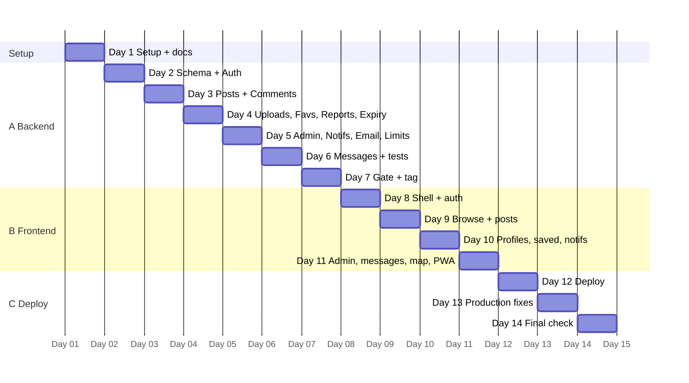

# 03. Roadmap

## Stages and timeline

| Stage             | Days  | What                                                | Ends with                                |
| ----------------- | ----- | --------------------------------------------------- | ---------------------------------------- |
| Setup             | 1     | Tools, scaffolds, docs                              | 3 links open                             |
| **A. Backend**    | 2–7   | All 27 features in the API, tested in Swagger       | "Backend done" gate + tag `api-v1.0.0`   |
| **B. Frontend**   | 8–11  | All pages, on the finished API                      | Big check on laptop + phone, 3 languages |
| **C. Deployment** | 12–14 | Neon, Render, Vercel, production fixes, final check | Final check of all 27 features           |

Phases inside stages A and B (finish one before the next): Phase 1 (features 1–7) → Phase 2 (8–14) → Phase 3 (15–21) → Phase 4 (22–27).

(Dates are relative; day 1 is the first working day.)

## Milestones

| Milestone                | When      | Condition                                                |
| ------------------------ | --------- | -------------------------------------------------------- |
| M1 Project runs          | Day 1     | `npm run dev` starts both apps; docs written             |
| M2 Phase 1 API           | Day 3     | Features 1–7 work in Swagger                             |
| M3 **Backend done gate** | Day 7     | All gate items checked (see CLAUDE.md), tag `api-v1.0.0` |
| M4 Frontend Phase 1–2    | Day 9     | Browse, detail, create work on phone + laptop            |
| M5 Frontend complete     | Day 11    | Big check passed in 3 languages                          |
| M6 Live                  | Day 12–13 | Site open on a real phone                                |
| M7 Done                  | Day 14    | All 27 features checked live                             |

## Feature priority

| #   | Feature                            | Phase | Difficulty | Value  |
| --- | ---------------------------------- | ----- | ---------- | ------ |
| 1   | Auth + username                    | 1     | Medium     | Must   |
| 2   | Post CRUD                          | 1     | Medium     | Must   |
| 3   | Categories                         | 1     | Easy       | Must   |
| 4   | Browse, filter, search, pagination | 1     | Medium     | Must   |
| 5   | Comments                           | 1     | Easy       | Must   |
| 6   | Detail + resolve                   | 1     | Easy       | Must   |
| 7   | My profile                         | 1     | Easy       | Must   |
| 8   | Price + unit                       | 2     | Easy       | High   |
| 9   | District + filter                  | 2     | Easy       | High   |
| 10  | Contact options                    | 2     | Easy       | Must   |
| 11  | Sort                               | 2     | Easy       | High   |
| 12  | Dark mode                          | 2     | Easy       | Medium |
| 13  | About page                         | 2     | Easy       | Low    |
| 14  | Counts per category                | 2     | Easy       | Medium |
| 15  | Images                             | 3     | Hard       | High   |
| 16  | 3 languages                        | 3     | Medium     | Must   |
| 17  | Favorites                          | 3     | Easy       | Medium |
| 18  | Public profile                     | 3     | Easy       | Medium |
| 19  | Expiry + renew                     | 3     | Medium     | High   |
| 20  | Report                             | 3     | Easy       | High   |
| 21  | Share                              | 3     | Easy       | Medium |
| 22  | Admin panel                        | 4     | Hard       | High   |
| 23  | Notifications                      | 4     | Medium     | Medium |
| 24  | University email                   | 4     | Medium     | Medium |
| 25  | Map                                | 4     | Medium     | Medium |
| 26  | Messages                           | 4     | Hard       | Medium |
| 27  | Rate limiting + blocked users      | 4     | Medium     | High   |

## Risks

| Risk                                                                             | Mitigation                                                                                          |
| -------------------------------------------------------------------------------- | --------------------------------------------------------------------------------------------------- |
| Slow internet / full disk makes installs fail (happened on day 1: disk was full) | Keep 10+ GB free; `npm cache clean --force`; retry installs one at a time                           |
| Package versions do not match (NestJS 11 vs newest packages, Prisma)             | Versions are pinned and listed in docs/05; do not run `npm update` blindly                          |
| Cookies fail on iPhone Safari after deploy                                       | `/api` proxy keeps cookies first-party; test on a real iPhone on day 13                             |
| Render free server sleeps (slow first request, cron misses)                      | Expiry check on read; keep-awake GitHub workflow every 14 min; tell users about the first slow load |
| Neon database sleeps                                                             | First query is slower; retry in Prisma; health check also touches the DB only when needed           |
| Brevo emails land in spam or the sender is rejected                              | Page tells users to check spam; `MailService` isolates the provider                                 |
| Cloudinary free limits                                                           | Compress images in the browser; max 5 images x 5 MB; delete files with the post                     |
| Time runs short                                                                  | Cut list below (only with owner's OK)                                                               |
| i18n keys forgotten                                                              | ESLint literal-string rule + `npm run i18n:check` in CI                                             |
| Frontend finds a backend gap                                                     | "Backend change requests" below; fix in server/, retag                                              |
| Service worker serves an old version                                             | `skipWaiting`, versioned cache, "new version" toast                                                 |
| Free-tier build minutes / limits reached                                         | Tell the owner in one line; reduce CI runs; use free alternatives                                   |

## Cut list (only after telling the owner and getting OK)

1. Feature 26 (messages)
2. Feature 25 (map)
3. Feature 24 (university email verification)

Phases 1–3 (features 1–21) are never cut.

## Backend change requests

_(empty at first)_

| #   | Date | Found on | Request | Status | New tag |
| --- | ---- | -------- | ------- | ------ | ------- |
